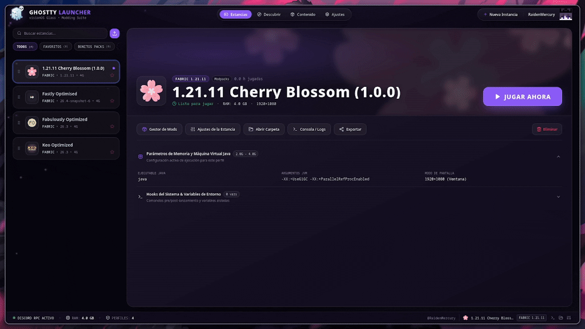
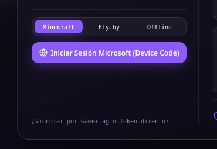
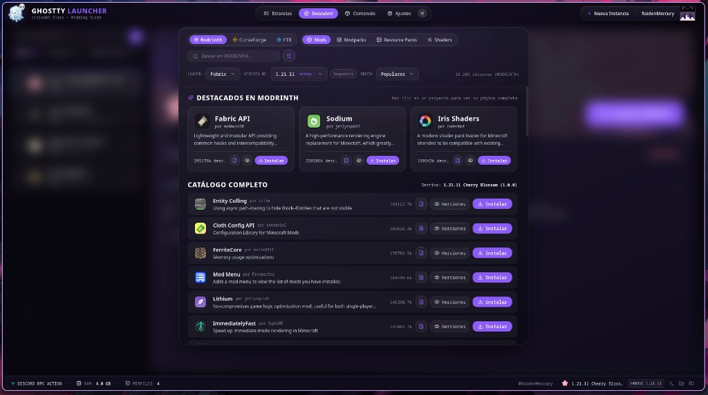
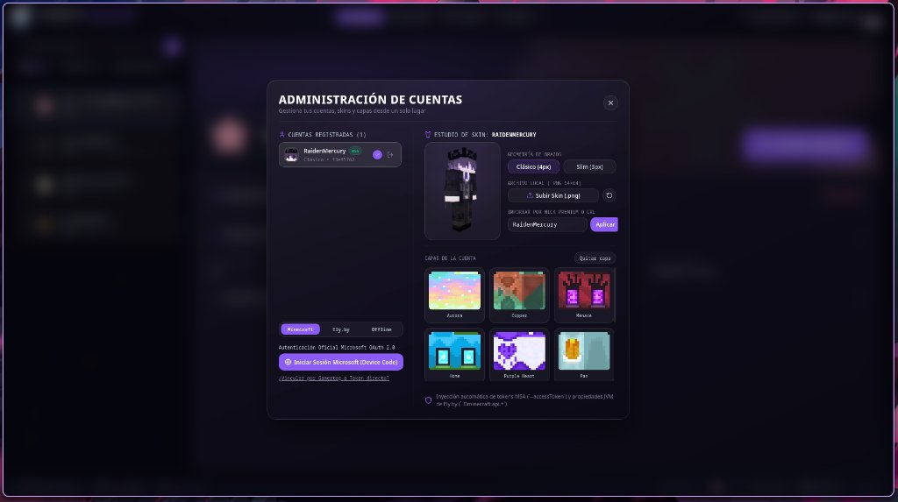
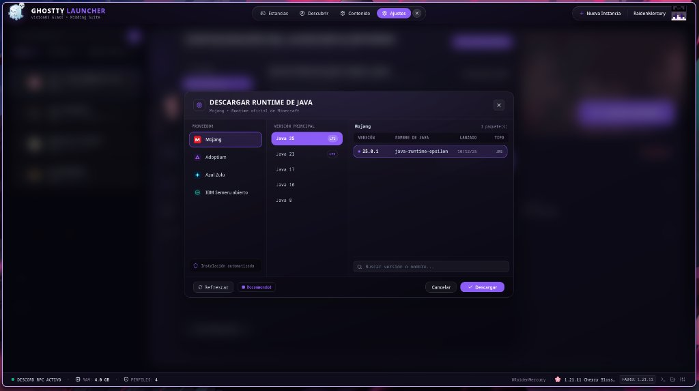
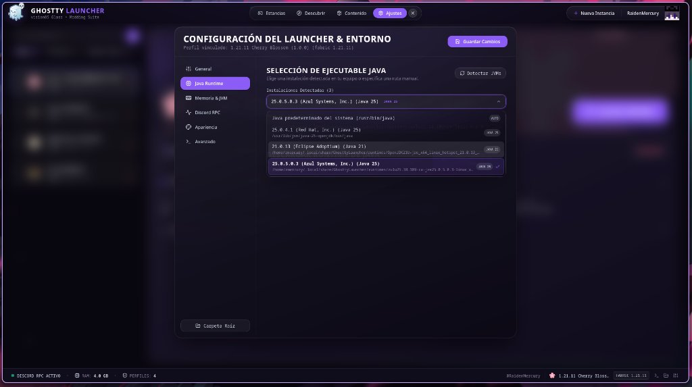

<p align="center">
  
</p>

<h1 align="center">Ghostty Launcher</h1>

<p align="center">
  <strong>El launcher de Minecraft para Linux rápido, fluido y visualmente deslumbrante.</strong>
</p>

<p align="center">
  Diseñado desde cero con <strong>Rust + Tauri 2</strong> y una estética <strong>visionOS Dark Glass</strong>.<br />
  Sin el peso muerto de Electron, sin interfaces anticuadas y con control absoluto sobre tus mods, runtimes y perfiles.
</p>

<p align="center">
  
  
  
  
  
</p>

---

<p align="center"></p> -->

---

## ¿Por qué Ghostty Launcher?

Durante años, la comunidad de Linux ha tenido que elegir entre dos extremos: launchers rápidos pero con interfaces de hace más de una década, o alternativas modernas sobrecargadas con gigabytes de RAM consumidos por navegadores embebidos.

**Ghostty Launcher destruye esa falsa dicotomía.** Combina la velocidad instantánea y seguridad de memoria de **Rust** con un motor de interfaz reactivo acelerado por hardware que se siente vivo en cada click, scroll y transición.

---

## Características Destacadas

### Rendimiento Nativo en Rust
- **Consumo mínimo de recursos:** Motor desacoplado que libera memoria y supervisa el proceso del juego en segundo plano sin ralentizar tu sesión de juego.
- **Descargas concurrentes de alta velocidad:** Conexión multihilo para bajar librerías de Mojang, assets indexados y mods de Modrinth a máxima velocidad de red.
- **Tolerancia a fallos:** Verificación criptográfica SHA-1 y SHA-256 en cada jar, parcheo dinámico de JPMS para Java 25 y compatibilidad comprobada en entornos Wayland (Hyprland, GNOME, KDE) y X11.

---

### Galería Visual

<table>
  <tr>
    <td width="50%">
      <h4 align="center">Gestor de Estancias & Canvas Hero</h4>
      
      <p align="center"><em>Filtros por grupos, favoritos, reordenamiento fluido y canvas en movimiento con el arte del modpack.</em></p>
    </td>
    <td width="50%">
      <h4 align="center">Explorador de Modrinth Integrado</h4>
      
      <p align="center"><em>Búsqueda directa e instalación en un click de mods (Sodium, Iris, Fabric API), modpacks, shaders y resource packs.</em></p>
    </td>
  </tr>
  <tr>
    <td width="50%">
      <h4 align="center">Estudio de Skins & Capas 3D</h4>
      
      <p align="center"><em>Previsualización interactiva con modelo clásico/slim, capas oficiales Mojang y soporte Ely.by / Offline.</em></p>
    </td>
    <td width="50%">
      <h4 align="center">Catálogo de Java Runtimes</h4>
      
      <p align="center"><em>Descarga e instalación automatizada de runtimes: Mojang JRE, Eclipse Temurin (Adoptium) y Azul Zulu.</em></p>
    </td>
  </tr>
  <tr>
    <td colspan="2">
      <h4 align="center">Ajustes del Entorno & Menús Desplegables Glass</h4>
      
      <p align="center"><em>Detección automática de JVMs instaladas, selectores estilizados GlassSelect, memoria RAM y hooks del sistema.</em></p>
    </td>
  </tr>
</table>

---

### Soporte Integral de Mod Loaders
- **Fabric & Quilt:** Soporte nativo de primera clase para perfiles ligeros y modding modular.
- **Forge & NeoForge:** Pipeline completo de resolución de librerías, compatibilidad con mods modernos de NeoForge (incluyendo Minecraft 26.x y Java 25) y compatibilidad con mods tradicionales.
- **Importación directa de Modpacks:** Arrastra archivos `.mrpack` o `.zip` directamente a la ventana para instalar modpacks completos con todas sus dependencias en un solo paso.

### Autenticación Oficial y Privacidad Absoluta
- **Microsoft OAuth 2.0 (Device Code):** Inicia sesión de forma 100% transparente directamente en `microsoft.com/link`. Tus credenciales nunca tocan el launcher.
- **Soporte Multi-Proveedor:** Alterna sin esfuerzo entre cuentas Oficiales Microsoft, cuentas comunitarias Ely.by o perfiles Offline para pruebas locales.

---

## Descarga e Instalación

### Formato AppImage (Recomendado para Fedora, Arch, Ubuntu, Debian)

1. Descarga el archivo `.AppImage` más reciente desde la sección de **Releases** de este repositorio.
2. Otorga permisos de ejecución al archivo:
   ```bash
   chmod +x GhosttyLauncher_0.1.0_amd64.AppImage
   ```
3. Ejecuta directamente:
   ```bash
   ./GhosttyLauncher_0.1.0_amd64.AppImage
   ```

> **Consejo para Fedora / Wayland:** Si tu sistema requiere forzar renderizado por memoria compartida en WebKitGTK, Ghostty Launcher lo detecta automáticamente o puedes usar:
> ```bash
> GHOSTTY_COMPOSITOR=shm ./GhosttyLauncher_0.1.0_amd64.AppImage
> ```

---

## Compilación desde el Código Fuente

### Requisitos Previos
- **Node.js:** Versión 20+ y `npm` o `pnpm`.
- **Rust Toolchain:** Versión estable (`cargo`, `rustc`).
- **Dependencias de sistema (Linux):**
  - Fedora: `sudo dnf install webkit2gtk4.1-devel openssl-devel curl libappindicator-gtk3-devel librsvg2-devel`
  - Ubuntu/Debian: `sudo apt install libwebkit2gtk-4.1-dev libssl-dev libgtk-3-dev libappindicator3-dev librsvg2-dev`
  - Arch Linux: `sudo pacman -S webkit2gtk-4.1 openssl gtk3`

### Pasos de Construcción

```bash
# 1. Clonar el repositorio
git clone git@github.com:RaidenMercury/ghostty-launcher.git
cd ghostty-launcher

# 2. Instalar dependencias de frontend
npm install

# 3. Ejecutar en modo desarrollo
npm run tauri dev

# 4. Compilar el paquete final para producción (AppImage)
npm run tauri build -- --bundles appimage
```

El binario empaquetado se generará en:
```text
src-tauri/target/release/bundle/appimage/GhosttyLauncher_0.1.0_amd64.AppImage
```

---

## Estructura de Directorios

Ghostty Launcher respeta los estándares del sistema de archivos en Linux (XDG Base Directory Specification):

```text
~/.local/share/GhosttyLauncher/
├── instances/           # Archivos, mundos y mods de cada perfil
├── runtimes/            # Java JREs descargados (Adoptium, Azul Zulu, etc.)
├── libraries/           # Librerías de Mojang y mod loaders cacheadas
├── assets/              # Texturas, sonidos y recursos del juego base
├── versions/            # Metadatos JSON y jars de clientes
├── caches/              # Descargas temporales e índices de mods
├── accounts.json        # Perfiles de jugador registrados
└── config.json          # Preferencias globales del launcher
```

---

## Licencia

Distribuido bajo la licencia **GNU General Public License v3.0 (GPL-3.0)**. Consulta [LICENSE](LICENSE) y [THIRD_PARTY_NOTICES](THIRD_PARTY_NOTICES) para más detalles.

- El backend incluye una adaptación en Rust de [minecraft-launcher-core-node](https://github.com/Voxelum/minecraft-launcher-core-node) (MIT, © 2023 CI010).
- Iconos de interfaz por [game-icons.net](https://game-icons.net) (CC BY 3.0) y [Lucide Icons](https://lucide.dev).

---

## Aviso Legal / Disclaimer

**NOT AN OFFICIAL MINECRAFT PRODUCT. NOT APPROVED BY OR ASSOCIATED WITH MOJANG OR MICROSOFT.**

*NO ES UN PRODUCTO OFICIAL DE MINECRAFT. NO ESTÁ APROBADO POR NI ASOCIADO CON MOJANG O MICROSOFT.*

Minecraft y el logotipo de Minecraft son marcas comerciales o marcas registradas de Mojang Studios / Microsoft Corporation. Ghostty Launcher es un proyecto de software libre e independiente creado por fans para la comunidad de jugadores, en estricto cumplimiento de las [Directrices Oficiales de Uso y Marca de Minecraft](https://www.minecraft.net/es-es/usage-guidelines).
